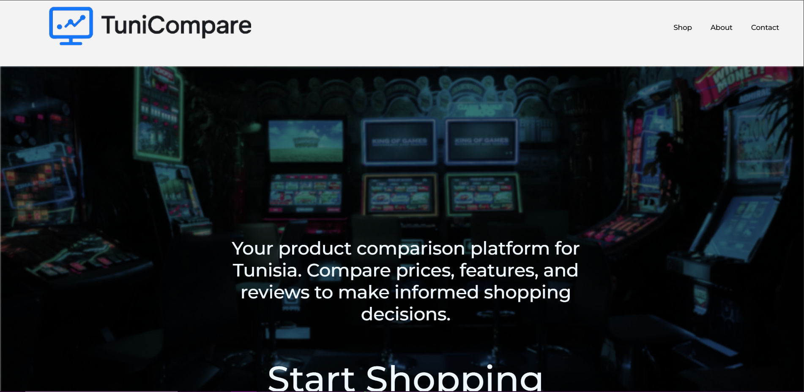
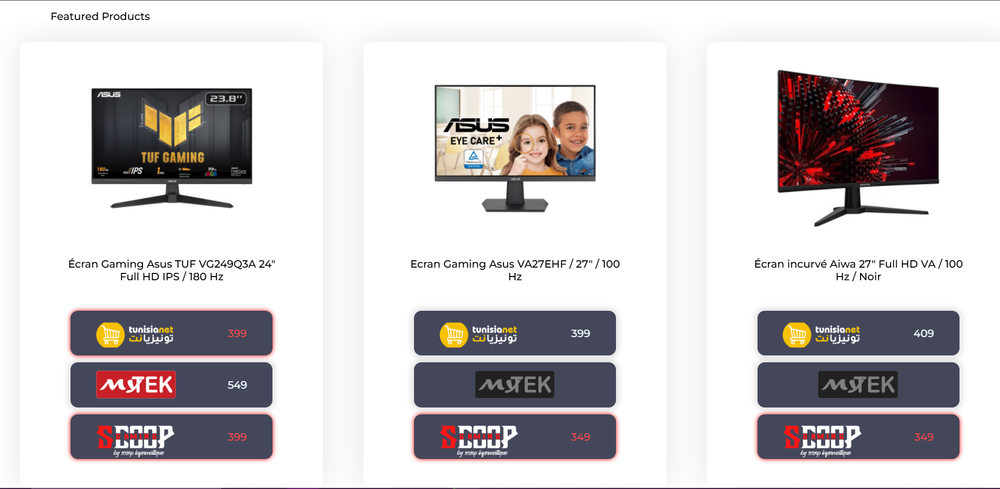
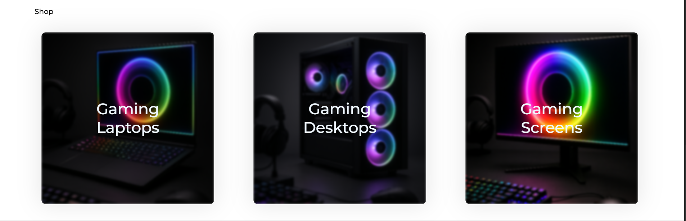
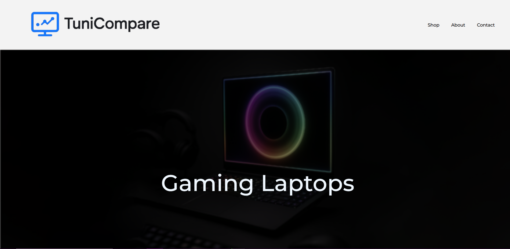
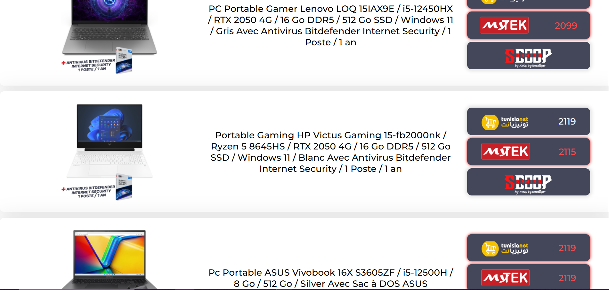
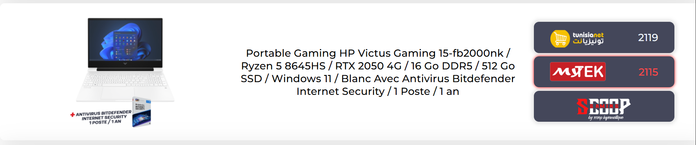

# 🛒 TuniCompare

[](https://python.org)
[](https://flask.palletsprojects.com)
[](https://sqlite.org)
[](https://en.wikipedia.org/wiki/Comma-separated_values)
[](https://developer.mozilla.org/en-US/docs/Web/JavaScript)
[](https://developer.mozilla.org/en-US/docs/Web/HTML)
[](https://developer.mozilla.org/en-US/docs/Web/CSS)

> 🎓 **Educational Project** | 📊 **Product Comparison Platform** | 🇹🇳 **Made in Tunisia**

TuniCompare is a lightweight product comparison platform built for educational purposes. It scrapes product data (💻 Laptops, 🖥️ Desktops, and 📺 Screens) from leading Tunisian e-commerce websites — **Mytek**, **Tunisianet**, and **ScoopGaming** — and serves it through a minimal Flask backend with a clean HTML/CSS/JavaScript frontend. The site design is responsive, modern, and optimized for clarity and usability.

## 📸 Visual Showcase

Take a closer look at TuniCompare's intuitive interface and powerful comparison features:

### 🏠 **Homepage Overview**


The TuniCompare homepage welcomes users with a sleek, modern design featuring a tech-inspired background that immediately conveys the platform's focus on technology products. The clean navigation bar provides easy access to Shop, About, and Contact sections, while the prominent call-to-action invites users to "Start Shopping" and begin their product comparison journey.

### ⭐ **Featured Products Section** 


Our intelligent featured products showcase highlights the most popular items based on sales data and user engagement. Each product card displays essential information including product images, detailed specifications, and real-time pricing from all three major Tunisian retailers. The visual hierarchy makes it easy to compare options at a glance.

### 🧭 **Category Navigation**


The category selection interface uses striking visual cards with RGB lighting effects that appeal to the gaming community. Users can seamlessly navigate between Gaming Laptops, Gaming Desktops, and Gaming Screens, with each category featuring distinctive visual themes that reflect the product type.

### 📋 **Product Listing Page**


Category pages maintain the same elegant design language with focused headers and clear product categorization. The "Gaming Laptops" page demonstrates the clean, distraction-free environment that helps users focus on comparing products without visual clutter.

### 🔍 **Dynamic Product Grid**


The product listing showcases our advanced infinite scroll system in action. Each product entry includes comprehensive specifications (CPU, GPU, RAM, storage), detailed product images, and our signature price comparison cards. The layout efficiently presents large amounts of technical data in an easily digestible format.

### 💰 **Smart Price Comparison Cards**


Our innovative price comparison system is the heart of TuniCompare's value proposition. Each product features retailer-specific cards with intelligent visual cues:

- **🔴 Red Shadow**: Indicates the best available price - helping users instantly identify the most cost-effective option
- **⚪ White Text**: Shows competitive pricing that's available but not the lowest
- **⚫ Grayed Out**: Displays unavailable products or out-of-stock items

This color-coded system allows users to make informed purchasing decisions at a glance, comparing prices across Tunisianet, MyTek, and ScoopGaming without visiting multiple websites.

## ✨ Key Features

- 🕷️ **Smart Web Scraping** — Custom Python scripts extract product data and export to structured .csv files grouped by category and source site. Data is then parsed and loaded into a SQLite database for dynamic querying.

- 🔧 **Intelligent Specs Extraction & Normalization** — Advanced parsing algorithms extract and standardize product specifications (CPU models, RAM capacity, GPU variants, storage types) from inconsistent raw data, enabling lightning-fast database queries and accurate comparisons.

- 🧠 **Complex Product Matching Algorithm** — Sophisticated multi-layer comparison system combining fuzzy string matching with deep specs analysis. The algorithm handles manufacturer naming inconsistencies, model variations, and specification formatting differences to accurately identify identical products across different retailers.

- 🔄 **Dynamic Product Loading on Scroll** — Seamless infinite scroll implementation that dynamically fetches and renders product batches as users browse, providing smooth performance even with large product catalogs while reducing initial page load times.

- 🎨 **Modern UI Design** — Built with pure HTML and CSS (no frameworks), featuring grid/flex layouts, component-based styling, and category-specific views.

- 💰 **Best Price Detection** — Intelligent price comparison system that automatically identifies and highlights the retailer offering the lowest price for each product, complete with visual indicators and savings calculations.

## 🛠️ Tech Stack

| Technology | Purpose | Badge |
|------------|---------|-------|
| **Python** | Backend logic, scraping, data parsing |  |
| **Flask** | Lightweight web framework for routing and APIs |  |
| **SQLite** | Relational database, built from the CSVs and shipped with the app |  |
| **CSV** | Data storage and interchange format |  |
| **Vercel** | Cloud platform for hosting and deployment |  |
| **JavaScript** | Dynamic frontend interactions |  |
| **HTML5/CSS3** | Semantic markup and responsive design |   |

## 🌟 Try It Out!

Ready to explore TuniCompare? You have two options to experience the platform:

### 🚀 Option 1: Live Demo (Recommended)
**Experience TuniCompare instantly — no setup required!**

[](https://tunicompare.vercel.app/)

**👆 Click above or visit:** `https://tunicompare.vercel.app/`

✨ **Why try the live demo?**
- 🎯 **Instant Access** — See the platform in action immediately
- 📱 **Fully Responsive** — Test on any device (mobile, tablet, desktop)
- 🔄 **Real-Time Data** — Browse actual scraped product comparisons
- 🎨 **Complete Experience** — All features and UI components available

---

### 🔧 Option 2: Run Locally
**Perfect for developers who want to explore the code!**

#### Prerequisites
- Python 3.12 or higher
- Git

#### Setup Instructions

1. **Clone the repository**
   ```bash
   git clone https://github.com/tammam-bt/TuniCompare.git
   cd TuniCompare
   ```

2. **Install dependencies**
   ```bash
   # Create virtual environment (recommended)
   python -m venv .venv
   source .venv/bin/activate  # On Windows: .venv\Scripts\activate

   # Install the app, build and scraper packages
   pip install -r requirements-dev.txt
   ```

3. **Build the database**
   ```bash
   # Rebuild tunicompare.db from the CSVs in Main/Products (no scraping, no database server)
   python -m Scripts.build_db
   ```
   To scrape fresh data first, run `python Run.py` instead (the scrapers date from summer 2025 and may need repairs).

4. **Start the Flask application**
   ```bash
   python app.py
   ```

5. **Run the tests** (optional)
   ```bash
   pytest
   ```

6. **Access locally**
   Open your browser and navigate to `http://localhost:5000`

The website will now be running on your local server with a fully populated database! 🎉

---

> 💡 **Pro Tip**: Start with the [live demo](https://tunicompare.vercel.app/) to get a feel for the platform, then set it up locally if you want to dive into the code and contribute!

## 📁 Project Structure

```
📦 TuniCompare/
├── 🚀 app.py                          # Main Flask application & routing
├── 🔄 run.py                          # Data scraping & database population
├── 📋 requirements.txt                # Python dependencies
├── 🐍 .venv/                          # Virtual environment
│
├── 📊 Main/
│   └── Products/                      # Raw scraped data storage
│       ├── 💻 laptops_mytek.csv
│       ├── 🖥️ desktops_tunisianet.csv
│       ├── 📺 screens_scoopgaming.csv
│       └── 📄 [Additional CSV files by category & site]
│
├── ⚙️ Scripts/                        # Backend processing modules
│   ├── 🕷️ scrapers/
│   │   ├── mytek_scraper.py
│   │   ├── tunisianet_scraper.py
│   │   └── scoopgaming_scraper.py
│   ├── 🔍 product_matcher.py          # Fuzzy matching algorithms
│   ├── 🗃️ database_manager.py         # PostgreSQL operations
│   └── 🔧 data_normalizer.py          # Specs extraction & standardization
│
├── 🎨 static/                         # Frontend assets
│   ├── CSS/
│   │   ├── 🎭 main.css               # Global styles
│   │   ├── 🏠 home.css               # Homepage specific
│   │   └── 🛍️ shop.css               # Product pages styling
│   ├── JS/
│   │   ├── ⚡ product_loader.js       # Dynamic scroll & API calls
│   │   ├── 🔍 search_filter.js       # Search & filtering logic
│   │   └── 💰 price_comparison.js     # Best price highlighting
│   └── Resources/
│       ├── 🖼️ logos/                  # Site & brand logos
│       ├── 📱 icons/                  # UI icons & graphics
│       └── 🎯 placeholders/           # Default product images
│
└── 📄 templates/                      # Jinja2 HTML templates
    ├── 🧩 base.html                   # Base template with common layout
    ├── 🏠 home.html                   # Landing page template
    └── 🛍️ shop/
        ├── 💻 laptop.html             # Laptop category page
        ├── 🖥️ desktop.html            # Desktop category page
        └── 📺 screen.html             # Screen category page
```

### 📂 Directory Breakdown

| **Component** | **Purpose** | **Key Files** |
|---------------|-------------|---------------|
| **🚀 Core Application** | Main Flask app and execution | `app.py` (routes & API), `run.py` (scraping pipeline) |
| **📊 Data Storage** | Raw CSV files organized by retailer and category | `Main/Products/*.csv` |
| **⚙️ Processing Scripts** | Backend logic for scraping, matching, and DB operations | `Scripts/scrapers/`, `product_matcher.py`, `database_manager.py` |
| **🎨 Frontend Assets** | Stylesheets, JavaScript, and media resources | `static/CSS/`, `static/JS/`, `static/Resources/` |
| **📄 Templates** | Jinja2 HTML templates with inheritance structure | `templates/base.html`, category-specific pages |

### 🔄 Workflow Overview

1. **`run.py`** → Executes scrapers → Normalizes data → Populates database
2. **`app.py`** → Serves templates → Provides API endpoints → Handles routing  
3. **Frontend JS** → Fetches data dynamically → Implements infinite scroll → Updates UI
4. **Templates** → Inherit from `base.html` → Category-specific layouts → Responsive design

## 🚀 Skills Developed

This project provided hands-on experience with:

- 🏗️ **Full-Stack Development** — Designing and structuring backend/frontend architecture
- 🕷️ **Web Scraping** — Writing robust scripts and handling real-world messy data
- 🗃️ **Database Management** — Working with SQL databases and schema design
- 🌐 **API Development** — Building lightweight REST APIs with Flask
- 🎨 **Frontend Design** — Creating responsive layouts without frameworks
- 🔍 **Data Processing** — Implementing fuzzy logic for inconsistent product matching
- ⚡ **Dynamic Scroll Loading** — Building infinite scroll pagination with JavaScript for optimal performance
- 🚀 **Cloud Deployment** — Deploying web applications and databases to production on Render platform

## 🤝 Support & Contribution

We'd love to hear from you! TuniCompare is an open educational project, and community interaction helps make it better.

### 🌟 Ways to Get Involved

- **⭐ Star this repository** if you find it useful or interesting
- **🐛 Report bugs** by opening an issue on GitHub
- **💡 Suggest features** or improvements through discussions
- **🔀 Submit pull requests** to contribute code improvements
- **📖 Share your experience** - let us know how you used this project for learning
- **🗣️ Spread the word** - share with fellow developers and students

### 📬 Get in Touch

- **GitHub Issues**: For bug reports and feature requests
- **Discussions**: For questions, ideas, and general conversation about the project
- **Educational Use**: If you're using this project for teaching or learning, we'd love to hear about your experience!

---

> 🎓 **Learning Project Notice**
> 
> This is a **non-commercial, educational-focused project**. All data is used strictly for learning purposes. The platform is **not intended** for:
> - 💰 Public release or monetization
> - 🏢 Commercial competition with original retailers
> - 📈 Profit generation of any kind
>
> Built with ❤️ for educational exploration and skill development.

---

## 🙏 Special Thanks

This project wouldn't have been possible without the incredible work of the technology teams behind the tools we use:

**🐍 Python Software Foundation** — For creating the versatile Python language that powers our backend logic and scraping capabilities.

**🌶️ Pallets Team** — For Flask, the elegant microframework that makes web development in Python a joy.

**🐘 PostgreSQL Global Development Group** — For the robust, reliable database system that handles our product data with precision.

**🚀 Render Team** — For providing an intuitive cloud platform that makes deployment accessible to developers everywhere.

**🌐 Mozilla Foundation & Web Standards Community** — For continuously pushing web technologies forward and maintaining comprehensive documentation.

**🛍️ Mytek, Tunisianet & ScoopGaming** — The Tunisian e-commerce pioneers whose platforms inspire and enable educational projects like this one.

**🇹🇳 Tunisian Tech Community** — For fostering innovation and supporting educational development in our region.

Every line of code, every database query, and every user interaction stands on the shoulders of these incredible teams and communities. Thank you for making technology accessible and empowering the next generation of developers! 🚀
